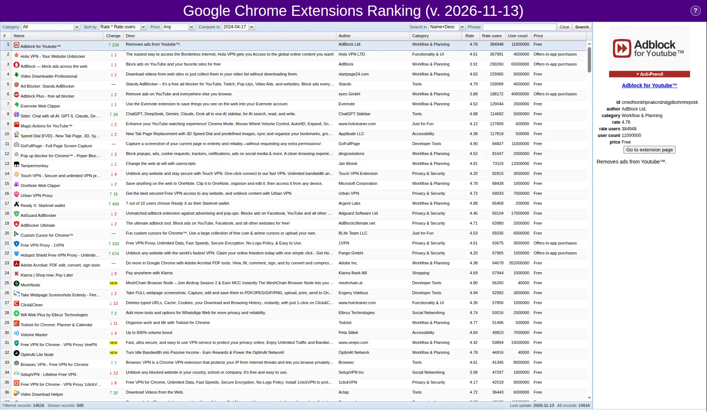

# Google Chrome Extensions Ranking

**Live demo: <https://chrome-ext-ranking.devlab4fun.workers.dev/>**

[](https://chrome-ext-ranking.devlab4fun.workers.dev/)

The Chrome Web Store cannot sort extensions by rating and popularity together. This page can: it ranks Chrome extensions
by **rating × number of ratings** (or by other criteria), lets you filter and search them, and shows **how positions changed**
since an earlier snapshot of the store.

It is a fully static site (Ext JS 4, no server, no sign-in) served by Cloudflare Static Assets.

## Features

- Ranking of ~14,500 extensions from the Chrome Web Store, with the date of the data in the title bar.
- Filter by **category** and **price** (any / free / non-free); sort by *Rate × Rate users*, *User count*, *Rate* and combinations.
- **Compare to** an earlier snapshot: the *Change* column shows positions gained or lost (↑ n / ↓ n) and marks new entries.
- Search by name, description or author.
- Details panel with the extension's image, author, ratings and user count; double-click a row to open it in the Chrome Web Store.
- Built-in user manual: the round **?** button in the title bar.

Included are extensions rated at least 3.0 by at least 10 people and used by at least 1,000 users; themes and Chrome Apps are left out.
The data comes from periodic snapshots (about one per year), so it is not live.

## Run locally

Requires Node.js.

```sh
git clone https://github.com/pkarpiuk/chrome-ext-ranking.git
cd chrome-ext-ranking
npm install
npm run dev        # http://127.0.0.1:8787/
```

## Deploy your own copy

```sh
npx wrangler login    # once: sign in to your Cloudflare account
npm run deploy        # uploads public/ as Cloudflare Static Assets
```

The free Cloudflare plan is enough: static asset requests are free and unlimited.

## Repository layout

| Path | Contents |
|---|---|
| `public/` | everything that is deployed: `index.html`, `main.js` (UI logic), `db.js` (data), icon sprite, bundled Ext JS, `_headers` (cache rules) |
| `wrangler.jsonc` | Cloudflare deployment config (`assets.directory = ./public`, no Worker script) |
| `README-tech.md` | technical notes (in Polish) |

## License

[GNU General Public License v3.0](LICENSE). The bundled Ext JS 4.2 (`public/ext-all.js`, `public/resources/`) is used under its GPL v3 option.

This project is not affiliated with or endorsed by Google. *Chrome* and *Chrome Web Store* are trademarks of Google LLC;
extension names, icons and descriptions belong to their respective authors.
